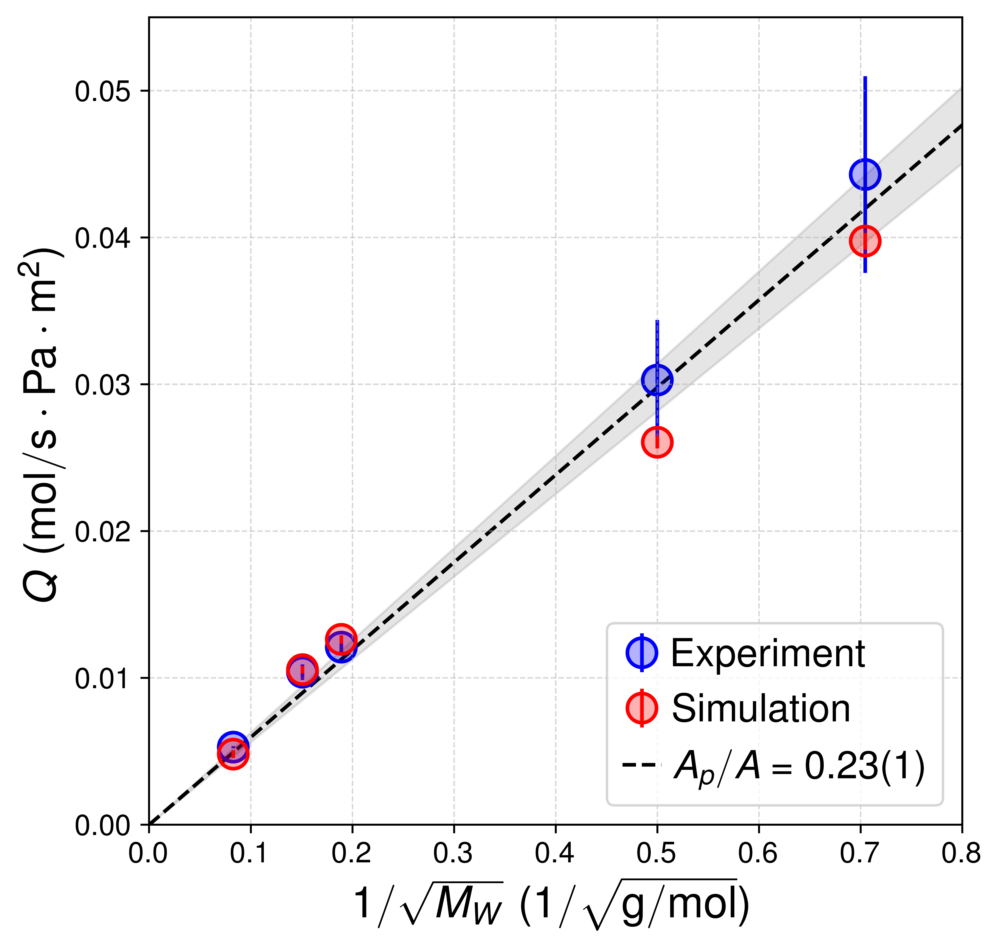
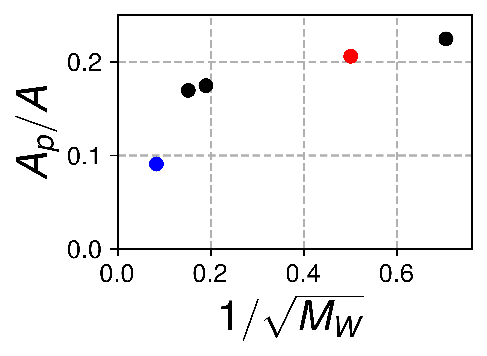
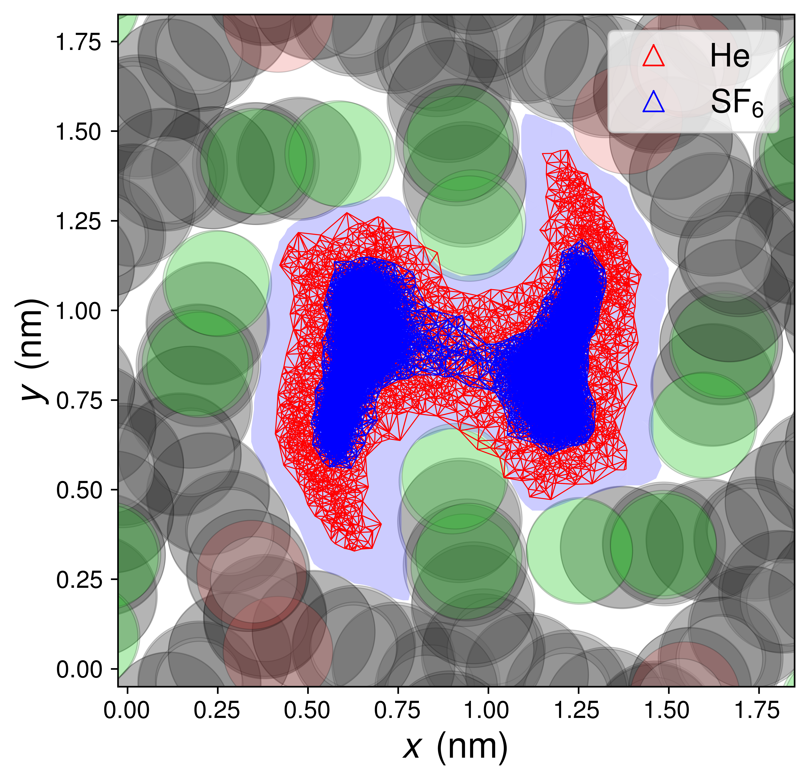

[](https://doi.org/10.5281/zenodo.23378206)

# Giant gas permeance through a nanoporous, crystalline 2D polymer

Jonathan D'Emidio, Daniel J. Murray, William B. Thompson, Jarvis C. Humlick, K. C. Schwab, Adrian Del Maestro, and Benjamin T. King

### Abstract

Chemical separation processes represent one of the largest contributors to industrial energy consumption, underscoring the need for the most efficient separation strategies. Many separation processes rely on selective transport through porous media. In this context, two-dimensional (2D) materials offer a promising route to atomically precise porosity beyond the reach of traditional top-down fabrication, with the potential to enhance separation performance by increasing flow. Here we report measurements of gas transport through a one-molecule-thick layer of suspended, nanoporous poly(carboxyfantrip), a 2D polymer that has identical, nanometer-sized pores that cover nearly a quarter of the surface. This combination of ultimate thinness with high areal pore density gives normalized gas flows (permeances) that approach the effusion limit, three to four orders of magnitude above gas-sieving graphene membranes. We find that gases spanning nearly two orders of magnitude in molecular weight (H<sub>2</sub>, He, N<sub>2</sub>, CO<sub>2</sub>, and SF<sub>6</sub>) obey Graham's law and approach the ideal limit of non-interacting ballistic transport, despite strong, species-dependent gas–pore interactions. Simulations reproduce the measured permeances within experimental uncertainty and provide an atomistic picture of the transport process. This work demonstrates the potential of synthetic crystalline 2D polymers for chemical separation, water filtration, and quantum sensing.

### Description

This repository contains Python scripts, simulation output, and figure panels for the paper above on gas transport through poly(carboxyfantrip). The scripts compare simulated and experimental gas permeance with Graham's law, plot the open area fraction determined from molecular crossing points, and compare the regions sampled by He and SF<sub>6</sub> within a pore.

The included plots correspond to Figure 1(d), Figure 1(e), and the inset to Figure 1(e). 

The permeance and pore-area comparisons include H<sub>2</sub>, He, N<sub>2</sub>, CO<sub>2</sub>, and SF<sub>6</sub>. The plotting scripts use numerical values stored directly in the source and simulation output included in the repository.

```text
data/       Pore geometry, gas positions, triangulations, and processed transport records
figures/    Generated PNG figures
src/        Python scripts for analysis and figure generation
```

### Data

| File or directory | Contents |
| --- | --- |
| [`data/pfan_coords_type`](data/pfan_coords_type) | Polymer atom types and in-plane coordinates used to draw the pore geometry. |
| [`data/pfanholepoints1.txt`](data/pfanholepoints1.txt) | Points describing the pore opening. |
| [`data/tri_xvals1`](data/tri_xvals1), [`data/tri_yvals1`](data/tri_yvals1) | Triangle coordinates used to shade the geometric pore opening and calculate its area. |
| [`data/jobsNp200/`](data/jobsNp200/) | He gas positions, triangulations, and transport records. |
| [`data/jobsSF6Np50FINALbetterLJ/`](data/jobsSF6Np50FINALbetterLJ/) | SF<sub>6</sub> gas positions, triangulations, and transport records. |

The permeance values and uncertainties are defined in [`src/pltfiggrahams.py`](src/pltfiggrahams.py). The gas-dependent pore-area fractions are defined in [`src/pltApVsGas.py`](src/pltApVsGas.py). These two scripts plot the stored values without recalculating them from the transport records.

The `launch_jobs` files retain paths from the original simulation environment. The release does not include the complete simulation inputs needed to rerun those jobs.

### Requirements

The figure-generation scripts require Python 3, NumPy, SciPy, and Matplotlib. 

All three scripts use LaTeX for text rendering, with the `helvet` and `sansmath` packages. A working LaTeX installation and `dvipng` must be available on `PATH` to generate the PNG figures.

### Reproducing the figures

Run the scripts from [`src/`](src/) so their relative data and output paths resolve correctly:


### Support

K. C. Schwab, Benjamin T. King, Adrian Del Maestro, and Jonathan D'Emidio acknowledge funding from the National Science Foundation QuSeC-TAQS program through Grant No. [2326801](https://www.nsf.gov/awardsearch/showAward?AWD_ID=2326801).


### Figures

#### Figure 1(d): Gas permeance and Graham's law

Simulated and experimental permeance as a function of inverse square root of molar mass, with a weighted linear fit and its slope uncertainty.

Generated by [`src/pltfiggrahams.py`](src/pltfiggrahams.py). [View the full-resolution PNG](figures/grahamslaw.png).



#### Figure 1(e), inset: Open area from molecular crossings

Open area fraction, $A_p/A$, computed by triangulating molecular crossing points, as a function of inverse square root of molar mass. He and SF<sub>6</sub> are highlighted in red and blue.

Generated by [`src/pltApVsGas.py`](src/pltApVsGas.py). [View the full-resolution PNG](figures/Ap.png).



#### Figure 1(e): He and SF<sub>6</sub> pore sampling

Triangulations of molecular crossing points for He and SF<sub>6</sub>, overlaid on the polymer geometry. The shaded pore opening is estimated from the kinetic radii of the poly(carboxyfantrip) atoms. The crossing-based open area fractions are approximately 0.21 for He and 0.09 for SF<sub>6</sub>.

Generated by [`src/plttrajectscomp.py`](src/plttrajectscomp.py). [View the full-resolution PNG](figures/HeSF6trajcomp.png).



### License

The repository software is released under the [MIT License](LICENSE).
